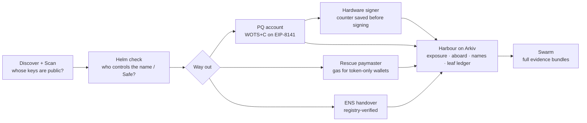

# Lifeboat, explained

A plain-words walkthrough of every part of Lifeboat: what it does, how it works, the proof, and what to say. The last sections hold the numbers to remember and the questions judges are likely to ask.

## 1. The story in one minute

- Your Ethereum **address** is a hash of your **public key**. While nobody has seen the public key, a quantum computer has nothing to attack.
- **Every signature reveals the public key.** Anyone can recover it from the signature with `ecrecover`. Sending a transaction is one kind of signature. Signing for a multisig, a vote or an order is another.
- A large enough quantum computer could turn a public key into its private key (Shor's algorithm). People call that day **Q-Day**. Nobody can do this today. Google's March 2026 estimate is about 1,200 logical qubits for an Ethereum key, far beyond current machines.
- **So the exposure is already on-chain.** Lifeboat measures it, shows who could take over what on Q-Day, and gives each one a way out.

The way out has three parts:
- a **post-quantum account** to move into;
- a **sponsor** that pays gas for wallets with no ETH;
- a **safe handover** for ENS names.

A **hardware signer** and a **public ledger** make sure the new one-time keys are never used twice.

## 2. The ideas behind it

**Public key vs address.** The address is the last 20 bytes of `keccak(publicKey)`. A hash can't be reversed, even by a quantum computer, so an address on its own is safe. Once a signature is out, the public key is out too.

**Why the usual check undercounts.** Most checkers ask "has this address sent a transaction?" (nonce > 0). A Safe signer can sign hundreds of Safe transactions and never send one itself. Its signatures sit in the Safe's `execTransaction` calldata, and the public key comes straight out of them.

**Hash-based signatures (the quantum-safe kind).** They rely only on a hash function, which quantum computers don't break. Our scheme is **WOTS+C** (Winternitz One-Time Signature, with a fixed checksum):
- **Picture a staircase** of 16 steps for each of 64 digits. The secret sits at the bottom of each staircase, and the public key is the top.
- To sign a digit `d`, you reveal step `d`. Anyone can climb from there to the top and check it matches. Climbing up is easy (hash again); climbing down is impossible.
- **Why "one-time":** a second signature with the same key reveals more low steps. An attacker then picks the lowest step seen on every staircase and can climb to sign *other* messages. That's a forgery.
- **The "+C" trick:** the signer tries counters until the digits of the message hash add up to exactly **560**. Any other message with the same sum must have a smaller digit somewhere, which would mean climbing down. So one signature never allows a forgery. As a bonus, the verifier always climbs exactly 64 × 15 − 560 = **400 steps**, so the gas cost is the same every time.

**A tree of one-time keys.** One account holds **256 one-time keys** (leaves) under one Merkle **root**. The account stores only the root. Each signature carries the leaf's 8 sibling hashes to prove the leaf belongs to the tree. The leaf's position is mixed into every hash, so a proof can't be moved to another position.

**The leaf floor.** The account stores a counter on-chain. Every transaction that lands raises it past the leaf it used, and VERIFY rejects any leaf below it. Old leaves are dead once a newer one lands.

**EIP-8141 frame transactions.** A transaction made of **frames**:
- **VERIFY** frames run the account's own code to check the signature, then call `APPROVE`.
- **SENDER** frames do the actual work: transfers and calls.

So an account can use **any signature scheme**, with no ECDSA, no bundler and no relayer. New opcodes let the code read the transaction: `TXPARAM` (sender, max cost, signature hash), `SIGDATACOPY` (the signature bytes), `FRAMEPARAM` / `FRAMEDATALOAD` (what the other frames do).

**The alternative mempool (ERC-8421).** The public mempool lets VERIFY read **only the sender's own storage**. If VERIFY could read shared state, one change to that state could invalidate thousands of waiting transactions for free, which is a denial-of-service risk. The alt mempool allows shared reads for a **staked** payer. The stake makes it accountable: the payer can be throttled or banned if its transactions go bad. A sponsor needs exactly that: to read its own registry and a token balance.

**Paymaster.** An account that pays someone else's gas. Ours pays for exposed wallets that have tokens but no ETH, and gets paid back in the token within the same transaction.

**ENSv2 control.** A name is a token in a registry, and control is spread over five places:
1. the **owner** of the token;
2. **delegates**, accounts holding roles on the name through Enhanced Access Control (EAC);
3. **operators**, approved for all of the owner's names, who can move it;
4. the **resolver**, which holds the records (address, text). Whoever holds its roles can rewrite them, and `UPGRADE` can replace its code;
5. the **parent registries** above the name.

**Arkiv.** A chain for **queryable data**. Each entity has typed, indexed attributes and an expiry, can be made **read-only**, and anyone can query it without a key.

**Swarm.** Decentralised storage. A file's reference is the hash of its content, so the link itself proves what's inside. Postage stamps pay for storage.

## 3. The parts, one by one

### Discover: hidden exposure (Ethereum mainnet)
- **What:** for a Safe, how many of its signer keys are already public, counting signatures and not just nonces.
- **How:**
  1. Read the owners and threshold.
  2. Check every owner's nonce on 5 chains.
  3. Fetch every `ExecutionSuccess` log, decode the `signatures` bytes of each execution, and recover each signer's public key. ECDSA signatures and `eth_sign` both work, and nested Safes are scanned too.
  4. If public keys ≥ threshold, the upgrade path is open on Q-Day.
- **Proof** (block 26,351,154, re-scanned 5 Nov):
  - Optimism Security Council, 10 of 13: 4 public keys by nonce → **13 of 13** counting signatures.
  - Base's nested 8-of-11 council: **0 → 11**.
  - The proof drawer shows one recovered public key with a link to the Safe transaction on Etherscan.
- **Code:** [`packages/core/src/safe-scan.ts`](../packages/core/src/safe-scan.ts), 3 unit tests. Details: [discovery.md](discovery.md).
- **Say:** "Multisig signers publish their key every time they sign. Counting that, Optimism's council goes from 4 to 13 of 13 public keys."

### Scan and Helm check (Sepolia ENSv2, plus any address on 6 chains)
- **What:** who can steer an ENS name on Q-Day, across all five control paths.
- **How:**
  1. Rebuild every role holder from the registry's and resolver's `EACRolesChanged` logs.
  2. **Prove the list is complete:** each role is one nybble, so the holders' bitmaps must add up to the registry's own `roleCount`. If they don't, the verdict is "unknown", never a false "protected".
  3. Classify every holder (exposed / not seen / PQ / contract). If any of paths 1–4 has an exposed holder, the name is **hijackable on Q-Day**.
- **The resolver trap:** transferring the name leaves the old resolver behind, and the old key still holds `SET_ADDRESS` and `UPGRADE` there.
- **The handover** (`lifeboatpq.eth`, 7 Sepolia transactions):
  1. The naive transfer is **refused** by the registry (`TransferUnsafeWithMultipleAssignees`).
  2. Lifeboat deploys a new resolver, points the name at it, revokes the delegate and removes the operator.
  3. The transfer is **accepted**.
  4. The PQ wallet then signs its own `pq.checked` record with a hash-based signature.
- **Proof:** `lifeboatdemo.eth` is hijackable through 4 paths; `lifeboatpq.eth` is protected. Every tx hash is in [helm-check.md](helm-check.md).
- **Say:** "Saving the money isn't enough if an old key can still point your name somewhere else."

### Escape 1: the post-quantum account (EIP-8141 devnet, chain 1337)
- **What:** a smart account whose only key is WOTS+C. Written in Yul, 2,294 bytes.
- **How:**
  1. VERIFY reads the 2,336-byte signature with `SIGDATACOPY`.
  2. It checks the leaf against the floor, climbs the 400 steps and checks the Merkle path.
  3. It calls `APPROVE`. The SENDER frame raises the leaf floor and makes the call.
- **Proof:** first transaction in **block 403,931**. VERIFY uses **52,369 gas**, and the check itself 44,870 every time (68k before we unrolled the loops).
- **Say:** "A hash-based signature checked natively in the transaction's VERIFY frame: 52k gas, the same for every signature."

### Escape 2: the rescue paymaster (chain 1337)
- **What:** a wallet with 0 ETH and 100 USDC escapes anyway.
- **How:** the paymaster's VERIFY checks four things:
  1. the sender is in its registry;
  2. the max cost is under its cap (0.01 ETH);
  3. the sender's token balance (read through the token's proxy) covers the fee;
  4. **the very next frame repays it**, and that frame isn't batched with later frames, so it can't be undone.
  Then it approves payment.
- **Proof, the same signed transaction three ways:**
  - Public mempool ❌ `StorageReadNonSender`.
  - Alt mempool, unstaked ❌ `unstaked payer accessed payer slot`.
  - Alt mempool, staked ✅ **included in block 404,050**.
  - Five attack variants are refused (underpaying, paying someone else, an undoable repayment, sweeping first, an unregistered sender).
- **Code:** [`RescuePaymaster.yul`](../contracts/yul/src/RescuePaymaster.yul), 517 bytes, 22,683 gas. Details: [rescue-paymaster.md](rescue-paymaster.md).
- **Say:** "The public mempool refuses it, the unstaked alt mempool refuses it, the staked one includes it. That's why this needs the alt mempool."

### Escape 3: the forgery (chain 1337)
- **What:** why one-time must mean one time.
- **How:**
  1. A naive wallet re-signs the same payment as 12 fee bumps with the **same leaf**.
  2. From those public signatures alone, the attacker takes the lowest step seen on each staircase.
  3. It tries counters for its own transaction until every digit is at or above those steps and the sum is still 560: **8,716 tries, under 0.1 s**.
  4. It climbs to a valid signature and submits it.
- **Proof:** VERIFY accepted it; **included in block 405,633**; the attacker received 0.01416 ETH. The leaf ledger then shows leaf 0 signing 16 different messages.
- **Forgery cost by reuse count:**

  | Reuses of one leaf | 2 | 5 | 12 |
  |---|---|---|---|
  | Tries to forge | ~2^64 | ~2^32 | ~2^18 |

- **Why it matters:** the EIP-8141 signature hash covers the fees, so **every fee bump is a new message**. Lifeboat uses a fresh leaf per attempt and saves it before the signature leaves the process. This issue is known in the hash-based-signature community; we credit it and show it live.
- **Say:** "A wallet that re-signs fee bumps with one key can be forged in a tenth of a second. We did it on the live devnet."

### Harbour: the public registry (Arkiv, plus Swarm)
- **What:** four schemas:
  - **exposure:** is this key public? Expires in 24 h.
  - **aboard:** a verified move to a PQ account. Read-only audit trail.
  - **name:** Helm check verdicts. Expires in 24 h.
  - **leaf:** the one-time-key ledger.
- **How:**
  - The publisher **re-checks every claim on-chain** before writing.
  - **Anyone can write a leaf sighting.** Two different messages for one leaf raise **"signed twice"**.
  - Full evidence bundles live on Swarm, linked from each entity by `swarmRef`.
- **Proof:**
  - The ledger caught the naive wallet's reuse.
  - The council findings are published at Safe level: 4 entities, with the full scan on Swarm.
  - 8 of 8 evidence bundles open on the public Swarm gateway.
  - `node scripts/arkiv-query-public.mjs` runs with no key.
- **Say:** "Every finding is re-checked, published, and expires unless it's checked again. Anyone can report a key used twice."

### Sign safely: the hardware signer (ESP32)
- **What:** the secret seed and the leaf counter live on the device.
- **How:**
  1. The device shows `SIGN?` on its OLED and waits for the **BOOT button**.
  2. It **saves the counter to flash before** computing anything, and refuses a counter that doesn't match its own digest.
  3. The laptop checks the signature before sending it.
  4. Keygen mixes the device's random generator with browser entropy, so neither side alone picks the key.
- **Proof:** a device-signed frame transaction was **included in block 406,887**. Keygen takes 35 s on both cores. The crypto core matches the TypeScript signer byte for byte.
- **Say:** "A crash or a reset can waste a leaf, but the device can't sign twice with one."

## 4. How it fits together

**Detect → map → escape → keep the name → sign safely → publish.** Each step works with any post-quantum destination. The PQ account is ours, but the scan, the Helm check, the registry and the rescue don't depend on WOTS+C.

## 5. What runs where

| Where | What | Real or test |
|---|---|---|
| Ethereum mainnet | Discover (read-only) | Real data |
| Sepolia | ENSv2 Helm check and handover, the Sepolia PQ wallet | Testnet ETH |
| EIP-8141 devnet (chain 1337) | PQ account, rescue paymaster, forgery, the hardware-signed tx | Devnet ETH, **mock USDC** |
| Arkiv Rabdi (7794095) | The registry | Testnet |
| Swarm (Sepolia) | Evidence bundles from our own Bee node | Testnet |
| On the table | ESP32 signer | Real hardware |

## 6. Numbers to remember

| Number | What |
|---|---|
| **4 → 13 of 13** | Optimism Security Council public keys, nonce vs signatures |
| **0 → 11** | Base's nested 8-of-11 council |
| **2 of 4** | top-level council Safes that look safe by nonce and aren't |
| **5** | ENSv2 control paths the Helm check covers |
| **52,369 gas** | the PQ account's whole VERIFY frame (44,870 for the check) |
| **2,336 bytes** | the signature (witness) |
| **256** | one-time leaves per key |
| **560 / 400** | the fixed digit sum / the hash steps the verifier always does |
| **❌ ❌ ✅** | public, unstaked, staked: the rescue admission |
| **22,683 gas** | the paymaster's VERIFY |
| **12 reuses → 0.1 s** | the forgery |
| **35 s** | keygen on the ESP32 |
| **Blocks 403,931 / 404,050 / 405,633 / 406,887** | first PQ tx / rescue / forgery / hardware-signed tx (chain 1337) |
| **17 + 23 + 3** | tests: TypeScript signer, Foundry contracts, Safe signature recovery |

## 7. Questions judges will likely ask

**General**

| Question | Answer |
|---|---|
| Can a quantum computer do this today? | No. These are readiness findings from public data. The deadlines are what make it urgent: NIST deprecates ECDSA after 2030 and disallows it after 2035 |
| Isn't a public exposure list a hit list? | We publish public infrastructure only (councils, bridges, DAOs), truncate signer addresses, count individuals without naming them, and brief owners privately first. Everything shown is already public on-chain |
| Why not just move to a fresh address? | A fresh address is safe only until it signs once. A real fix needs a quantum-safe signature scheme, and names and Safes need their *control* moved, not just their funds |
| How accurate is the detection? | It's a lower bound across the channels we list. Executions routed through other contracts (1–4%) are skipped. Anyone can check the proof drawer's key against Etherscan |
| What's new here? | Hidden exposure at council level, including nested Safes; the ENSv2 Helm check with a completeness proof; the three-way rescue admission; cheap WOTS+C combined with a hardware counter and a public leaf ledger. The fee-bump reuse problem is known; we credit it and show it live |

**EF: frame transactions and the alt mempool**

| Question | Answer |
|---|---|
| Why stateful WOTS+C, not leanSPHINCS? | It fits today's gas: 52k against the 100k prefix cap, while SPHINCS-style verification costs far more. We make the state safe (counter saved before signing, on-chain floor, public ledger). The rest of Lifeboat is scheme-agnostic, so leanSPHINCS can be the destination when it ships |
| Why does this need the alt mempool? | The sponsor must read its registry and a token balance during VERIFY. The public mempool refuses that by its rules; the staked alt mempool admits it. We show the exact rejection messages |
| Can the paymaster be drained? | It checks a cost cap, its registry, the token balance and the repayment frame. Five attack variants are refused on the live devnet |
| What about racing the rescue after Q-Day? | After Q-Day the attacker has the key too, so the rescue has to happen before. If a wallet is drained first, the balance check fails and the sponsor pays nothing |
| Why did the forgery work with a leaf floor? | The floor protects old leaves once a newer transaction lands. None of the 12 fee bumps had landed, so the reused leaf was still live. The fix is a fresh leaf per signature |
| Fee bumps with a fresh leaf each time: doesn't that waste leaves? | Yes, one per attempt. 256 leaves is a lot of attempts, and a key rotation (`setRoot` in a SENDER frame) is planned |
| Parallel transactions? | The leaf floor serialises them. A used-leaf bitmap (as in our Sepolia wallet) allows parallel lanes; see [pq-account.md](pq-account.md) |

**ENS**

| Question | Answer |
|---|---|
| Why isn't transferring the name enough? | The resolver stays behind, and the old key still holds its roles there, including `SET_ADDRESS` and `UPGRADE` |
| How do you know you found every role holder? | The registry stores role counts. The holders we rebuild from logs must add up to `roleCount` exactly, or we say "unknown" |
| Does it work for any name? | Yes, any ENSv2 name on Sepolia. Nothing is hard-coded |
| What are the `pq.*` records for? | So any wallet can read `pq.status` and warn before sending to an exposed name. There's a draft ENSIP in [pq-records.md](pq-records.md) |

**Arkiv and Swarm**

| Question | Answer |
|---|---|
| Why Arkiv, not a database? | It's a public, queryable record anyone can read without asking us. The audit trail is read-only even for us, and anyone can add a leaf sighting |
| Why do entries expire? | Balances and roles change. A reading is true for a block, so it expires in 24 h unless it's checked again |
| Isn't the publisher a trusted writer? | It re-checks every claim on-chain before writing, and every entry links its evidence, so anyone can verify. The leaf ledger is open to every writer |
| Why Swarm? | Full reports are bigger than Arkiv's 128-byte strings. A Swarm reference is the hash of the content, so it proves what it points to |

**Hardware**

| Question | Answer |
|---|---|
| Is it a secure element? | No. We claim only what it does: approval on the device, a counter saved before signing, and the secret never leaving the device |
| What if someone erases the flash? | Then the counter can roll back. The on-chain floor and the public ledger catch reuse, an eFuse counter would survive an erase, and the Dabao's hardware counters are why we want that board |
| Why does the laptop find the counter? | Finding the counter needs no secret. The device re-checks it and refuses a wrong one |

**Business**

| Question | Answer |
|---|---|
| Who pays? | Protocols with upgrade keys first: rollups, bridges, councils and DAO treasuries. They pay for monitoring, assessments and migration help. See [business-model.md](business-model.md) |
| What happens after the hackathon? | Private briefings to the councils, the ENSIP on the ENS forum, a public API beta, and the Dabao signer for Crossbar (15 Dec) |

## 8. Limits to say before anyone asks

- The demo uses devnet ETH and mock USDC. Frame transactions aren't on mainnet yet.
- Each key holds 256 leaves; key rotation is planned, not built.
- The discovery results are lower bounds, re-measured here for four council Safes only. The wider pre-event study isn't re-run in this repo.
- The ESP32 counter lives in flash, which can be erased. The hardware-counter version is the Dabao, pending the booth fix.
- The ESP32 is a hackathon signer, with no side-channel resistance claimed.

## 9. Wording rules

- Say "**the upgrade path is controlled by keys whose public keys are already on-chain**", not "can be drained".
- Open with "**No quantum computer can do this today**" whenever numbers come up.
- State the fact first, in the positive. Keep lines short.
- Name public infrastructure only, and count individuals without naming them.
